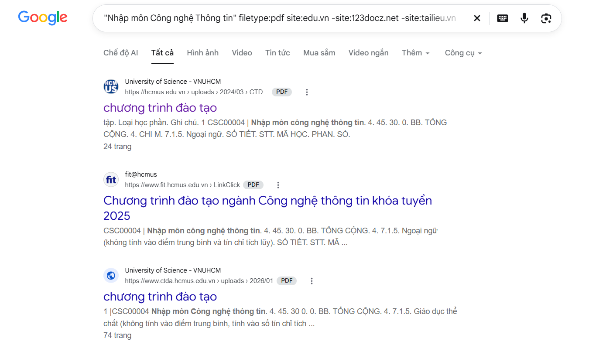

### Chuỗi truy vấn (Query):
```
"Nhập môn Công nghệ Thông tin" filetype:pdf site:ptit.edu.vn -site:123docz.net -site:tailieu.vn

```
`"..."`: Tìm chính xác cụm từ khóa.

`filetype:pdf`: Chỉ lấy trực tiếp tệp PDF.

`site:ptit.edu.vn`: Giới hạn trên máy chủ của Học viện (PTIT). 

`-site:...`: Loại bỏ các trang thương mại bắt nạp thẻ.

### Tại sao `filetype`: tiết kiệm thời gian hơn? 

- Mở thẳng tệp gốc:Bấm vào là tải/xem ngay file PDF, không phải đi qua các trang web trung gian hay bài viết giới thiệu.
- Tránh trang rác & mã độc: Lọc sạch các trang SEO bẩn, nút tải giả mạo hoặc web bắt nạp tiền vốn luôn đứng top khi gõ "tải sách...".
- Giảm thao tác thừa: Không tốn công click vào rồi lại bấm thoát ra vì tìm không thấy link tải thật.


